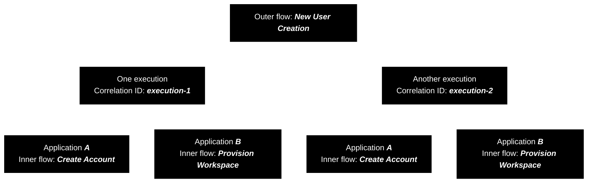
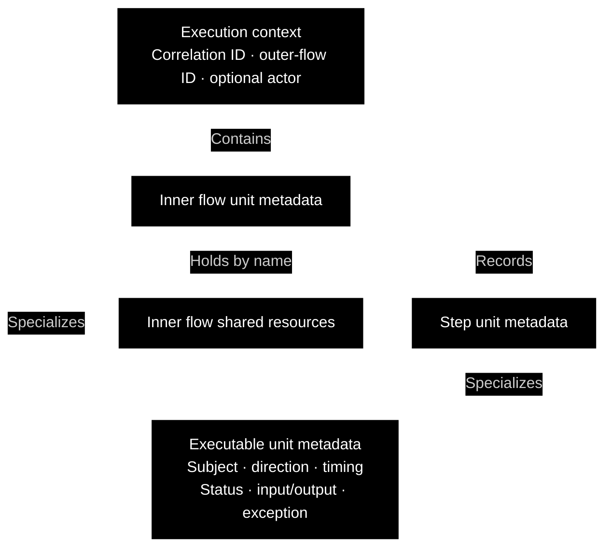
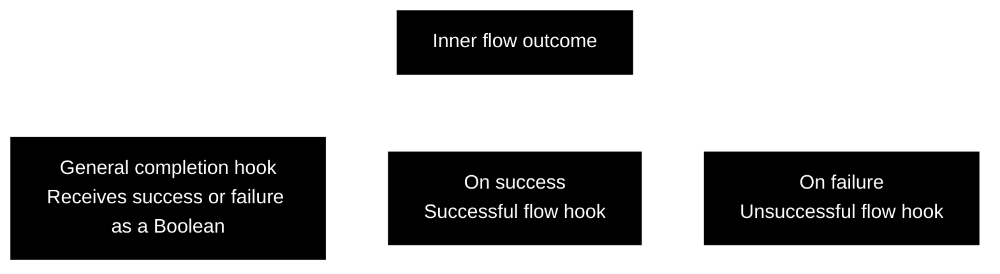

CAE Concept

---

 

### Clean Execution Context

A single request can set several operations in motion. Creating a user, for example, might require one application to create an account and another to provision a workspace. Each application performs smaller operations along the way, such as checking for an existing account or saving a record.

To understand that execution, application code needs to connect the work to the original request, identify who initiated it, and record what ran and how it completed.

An **Execution Context** is a container that accompanies the work and brings this information together. Business input describes what an operation is asked to do; the context carries information about the execution in which it participates.

 

#### Standalone Use

The execution context is a standalone component that application code can import and use directly. It does not require an application framework, a dependency injection container, or a framework-managed execution lifecycle.

The caller creates the context, supplies the execution information, and passes it to participating operations. Those operations use the execution context's APIs to record metadata and access resources shared within the inner flow. The same approach works in a script, a command-line tool, or a framework-based application.

The calling code explicitly controls where the context is created, how it is passed, and when the recorded work starts and finishes.

 

#### Execution Identity versus Flow Identity

A process describes work that can be performed repeatedly. An execution is one particular occurrence of that work: creating ***Alice***'s user and creating ***Bob***'s user are two executions of the same process.

A **correlation ID** identifies that specific execution instance. Participating work carries the same correlation ID across application boundaries so it can be associated with the same execution. A separate execution has a different correlation ID.

The process itself is described at two levels:

- **Outer flow:** the broader process across the system, such as ***New User Creation***. The **outer-flow ID** identifies this process and remains the same across its different execution instances.
- **Inner flow:** the workflow performed within a single application as a part of the broader outer flow, such as ***Create Account*** or ***Provision Workspace***. Such an application capability can also be called a **[use case](https://github.com/clean-arch-enablers-project/clean-use-cases/blob/feature/hello-world/concept/README.md)**.

When ***Alice***'s user is created, ***Create Account*** ([use case](https://github.com/clean-arch-enablers-project/clean-use-cases/blob/feature/hello-world/concept/README.md) ***A***) and ***Provision Workspace*** ([use case](https://github.com/clean-arch-enablers-project/clean-use-cases/blob/feature/hello-world/concept/README.md) ***B***) participate in one execution of ***New User Creation*** (outer flow) and share its correlation ID. Creating ***Bob***'s user involves the same outer-flow ID, but a different correlation ID. Each application's inner flow retains its own execution metadata and outcome.

The execution context carries the correlation ID, outer-flow ID, optional actor, and metadata for the current inner flow.

 

#### Actor

The **actor** is the user or system acting within the execution. When present, the actor information includes an identifier and a collection of **scopes**: values describing the permissions or access associated with that actor.

For example, an application might use the actor's identity and scopes to decide whether it may create accounts on behalf of another user.

Authentication establishes who the actor is; authorization determines whether that actor may perform an action. The context carries actor information for those decisions. Actor information is optional, allowing executions without an identified actor.

 

#### Inner Flow and Steps

The **inner flow** represents the workflow being executed within the application, typically a [use case](https://github.com/clean-arch-enablers-project/clean-use-cases/blob/feature/hello-world/concept/README.md). Its metadata describes the execution as a whole and groups its recorded operations and shared resources.

A **step** is an operation tracked within that workflow. The ***Create Account*** workflow might record ***Find Existing Account*** and ***Save Account*** as steps, each with its own timing and outcome.

Calls to **ports** are a primary use. A port is a contract declaring an operation the workflow needs from a dependency, such as retrieving or saving an account. Steps can also record internal operations and ordinary method calls; tracking an operation does not require a port or a particular architectural interface.

The corresponding entities are **inner flow unit metadata**, which holds the whole application's internal workflow metadata, steps, and shared resources, and **step unit metadata**, which holds metadata for an individual tracked operation within a workflow.

A step's outcome is separate from the workflow's outcome. For example, a failed remote lookup may be replaced by an acceptable cached result, allowing the inner flow to succeed despite the failed step.

 

#### Common Execution Metadata

Both an inner flow and a step represent work being executed. They therefore share a common set of descriptive information, called **metadata**, defined by **executable unit metadata**:

- **Subject:** the work being executed, such as ***Create Account*** or ***Save Account***.
- **Direction:** whether the unit represents inbound work entering the application or outbound work directed toward a dependency.
- **Timing:** when execution starts and ends, supporting duration calculation.
- **Status:** whether the completed unit was successful or unsuccessful.
- **Input and output:** optional records of what the unit receives and produces.
- **Exception:** the failure associated with the unit, when present.

Inner flow unit metadata and step unit metadata specialize this common metadata. Each recorded unit has its own lifecycle:

1. Before execution, it has not started.
2. Starting records the beginning of the work.
3. Completion records success or failure and the end time.

Input, output, and exceptions can contain sensitive information. Recording them does not automatically make them suitable for exposure; the application must decide what may be shared and with whom.

 

#### Inner Flow Shared Resources

Several operations within one workflow may need the same resource. For example, multiple database operations might participate in one transaction that should be committed only if the whole workflow succeeds.

The inner flow's metadata holds the shared resources in a map, allowing participating operations to retrieve each resource by name. The shared resources belong to the current inner flow rather than application-wide storage.

An **inner flow shared resource** holds the actual resource together with **completion hooks**: callbacks for actions to perform when the inner flow finishes.

- **General completion:** receives a Boolean indicating whether the flow succeeded.
- **Successful flow:** performs an action when the flow succeeds.
- **Unsuccessful flow:** performs an action when the flow fails.

For the database transaction example, the success hook can commit the transaction and the failure hook can roll it back. These actions respond to the outcome of the whole inner flow, rather than an individual step.

The code responsible for a resource must also define who releases it. Making the resource accessible through the context does not establish ownership by itself. The rules for completion-hook ordering and completion-hook failures must be explicit so a completion error does not obscure the original workflow failure.

Separate executions keep their mutable data separate. If operations run concurrently within one execution, access to shared data and resources requires coordination.

 

#### Execution Information in Context

The execution context connects a particular execution to the broader process, the actor involved, and the workflow running within an application. The inner flow and its steps describe what happened at each level, while shared resources allow participating operations to work with resources scoped to that workflow.

The execution context's structured information provides a consistent account of an execution for application code and diagnostic tools. Logging, metrics, and other monitoring mechanisms decide how to consume and publish that information.

 
 

---

clean software, made easy.

